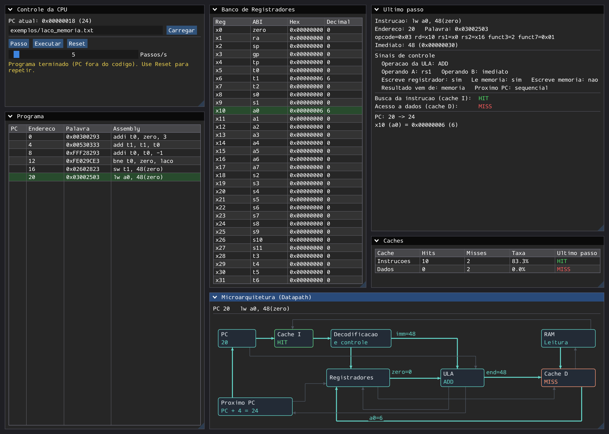

# Simulador RISC-V

Simulador didático de Arquitetura de Computadores escrito em C++17. O montador traduz um programa em Assembly e a CPU monociclo executa 37 instruções do RV32I. A cada passo, a interface mostra o caminho dos dados, o próximo PC, o registrador escrito e os acessos às caches de instruções e de dados.

[Abrir no navegador com Docker](#abrir-o-simulador-no-navegador) · [Rodar no macOS](#compilar-e-rodar-no-macos) · [Guia de estudo e apresentação](docs/guia-de-estudo.md) · [Histórico do projeto](handoff.md)



*Último passo do exemplo do laço. A instrução `lw a0, 48(zero)` é encontrada na cache de instruções (HIT). A cache de dados busca o bloco na RAM (MISS), `a0` recebe 6 e o PC avança de 20 para 24.*

## Abrir o simulador no navegador

Com o Docker em execução, rode na raiz do repositório:

```sh
docker build -t simulador-riscv .
docker run -d --rm --name simulador-riscv -p 127.0.0.1:6080:6080 simulador-riscv
```

Abra a [interface local no navegador](http://localhost:6080/vnc.html?autoconnect=true&resize=scale). O navegador mostra a janela do simulador por noVNC. A aplicação roda dentro do container com renderização por software. A porta fica restrita ao computador local porque a sessão VNC dispensa senha.

Para carregar um programa próprio pelo navegador, copie o arquivo para o container com `docker cp meu_programa.txt simulador-riscv:/app/meu_programa.txt`. Na interface, digite `meu_programa.txt` no campo de caminho e clique em **Carregar**.

Para encerrar, execute `docker stop simulador-riscv`. A opção `--rm` remove o container ao parar. A imagem pode ser usada de novo com o mesmo `docker run`.

## Compilar e rodar no macOS

Para abrir uma janela nativa, use o compilador das Command Line Tools do Xcode e as bibliotecas do Homebrew. Instale as dependências uma vez com `brew install glfw pkgconf`. Na raiz do repositório, compile o executável:

```sh
mkdir -p build && c++ -std=c++17 -O2 -DGL_SILENCE_DEPRECATION -Iinclude -Iimgui -Iimgui/backends \
  $(pkg-config --cflags glfw3) src/*.cpp gui/interface.cpp imgui/imgui*.cpp \
  imgui/backends/imgui_impl_glfw.cpp imgui/backends/imgui_impl_opengl3.cpp \
  $(pkg-config --libs glfw3) -framework Cocoa -framework OpenGL -framework IOKit \
  -o build/simulador_gui
```

Execute `./build/simulador_gui` a partir dessa mesma pasta para que a interface encontre `exemplos/laco_memoria.txt`. Depois da primeira compilação, também é possível abrir a janela com dois cliques em [Abrir Simulador (macOS).command](Abrir%20Simulador%20%28macOS%29.command). Recompile quando alterar o código C++.

## Primeiro passo na interface

1. Ao iniciar, a janela **Controle da CPU** carrega `exemplos/laco_memoria.txt`. Clique em **Passo**. O PC deve ir de 0 para 4, `t0` deve receber 3 e a primeira busca deve aparecer como **MISS**.
2. Use **Executar** para continuar, **Pausar** para interromper e **Passos/s** para ajustar a velocidade de 1 a 120 instruções por segundo. **Reset** recria a CPU e recarrega o programa desde o endereço zero.
3. Para observar um conflito de cache, digite `exemplos/conflito_cache.txt` e clique em **Carregar**.

| Janela | O que observar |
|---|---|
| Controle da CPU | PC atual, caminho do arquivo, controles de execução e mensagens de término ou erro. |
| Programa | Endereço, palavra de máquina e Assembly do programa carregado. A seta indica a próxima instrução. |
| Banco de Registradores | O layout inicial de 1280 × 914 acomoda os 32 registradores e o datapath inteiro. Em telas mais baixas, o banco permite rolagem. Cada linha mostra o nome ABI e os valores hexadecimal e decimal com sinal. O último destino de escrita aparece em verde. |
| Ultimo passo | Instrução, campos decodificados, imediato, sinais de controle, registrador de destino e PC antes e depois do passo. |
| Caches | Hits, misses, taxa de acerto e resultado do último passo para instruções e dados. |
| Microarquitetura (Datapath) | Mostra o caminho do último passo pelo PC, pelas caches, pela decodificação e controle, pelos registradores, pela ULA e pela RAM. As setas destacadas mostram os operandos, o endereço de memória, o dado do store ou o retorno para o registrador. O bloco **Proximo PC** indica a decisão de desvio e o próximo endereço. |

## Exemplos para executar por passos

A interface usa 4096 bytes de RAM. Os testes destes exemplos usam 256 bytes e produzem os mesmos resultados. Carregar o programa ou clicar em **Reset** inicia a CPU com PC em zero e caches vazias. Cada clique em **Passo** executa uma instrução. A interface indica o fim quando o PC sai da área do código carregado.

| Programa | O que observar | Estado ao terminar | Cache de instruções | Cache de dados |
|---|---|---|---|---|
| [Laço e memória](exemplos/laco_memoria.txt) | Soma 3 + 2 + 1 em `t1`. O `bne` no endereço 12 volta ao endereço 4 duas vezes. O `sw` grava a soma em 48 e o `lw` a lê em `a0`. | 12 passos, PC = 24, `t0 = 0`, `t1 = a0 = 6` | 10 hits, 2 misses | 0 hits, 2 misses |
| [Conflito na cache](exemplos/conflito_cache.txt) | Lê o mesmo byte com `lb` e `lbu`. Os endereços 64 e 192 disputam a linha 4. O store em 192 preserva o bloco de 64 e o load em 192 o substitui. | 9 passos, PC = 36, `a0 = a3 = 0xFFFFFFFF`, `a1 = 255`, `a2 = a4 = 65535` | 6 hits, 3 misses | 3 hits, 5 misses |

O [teste de integração](tests/teste_montador_cpu.cpp) monta esses mesmos arquivos e confere os resultados. No exemplo do laço, o primeiro acesso de dados é um store com miss. Como ele escreve diretamente na RAM, o load seguinte também dá miss e traz o bloco para a cache.

## Do Assembly à execução

Os exemplos usam arquivos de texto `.txt` com uma instrução em Assembly por linha. O [montador](src/montador.cpp) lê o conteúdo em duas passagens, independentemente da extensão do arquivo. Na primeira, atribui um endereço a cada rótulo, contando quatro bytes por instrução. Na segunda, codifica cada instrução em uma palavra de 32 bits. Para um branch ou `jal` com rótulo, o deslocamento em bytes é o endereço do rótulo menos o PC da própria instrução.

Escreva os mnemônicos em minúsculas, uma instrução por linha, sem comentários. Use registradores numéricos (`x0` a `x31`) ou nomes ABI como `zero`, `t0` e `a0`. O montador aceita imediatos decimais e hexadecimais (`0x`), ignora linhas em branco e reconhece rótulos em linhas próprias, como `laco:`. Para loads e stores, use `lw a0, 48(zero)` e `sw t1, 48(zero)`. Para o salto por registrador, a sintaxe aceita é `jalr rd, rs1, imm`.

Para reproduzir o carregamento em C++, use `montar_arquivo()` e carregue o vetor na CPU que receberá as chamadas a `passo()`. Este trecho usa as declarações de [montador.h](include/montador.h) e [cpu.h](include/cpu.h).

```cpp
const auto palavras = montar_arquivo("exemplos/laco_memoria.txt");
CPU cpu(256);
std::uint32_t endereco = 0;
for (auto palavra : palavras) {
    cpu.carregar_instrucao(endereco, palavra);
    endereco += 4;
}
cpu.passo();  // Primeiro passo do laço: t0 recebe 3 e o PC avança para 4.
```

A função `carregar_programa(caminho, memoria, inicio)` grava as palavras na instância de `Memoria` passada pelo chamador. A CPU tem sua própria RAM. Um rótulo desconhecido ou um registrador inválido durante a montagem gera `std::runtime_error` com o número da linha para exibição na interface.

## Instruções implementadas

| Grupo | Instruções |
|---|---|
| Operações entre registradores | ADD, SUB, AND, OR, XOR, SLL, SRL, SRA, SLT, SLTU |
| Operações com imediato | ADDI, ANDI, ORI, XORI, SLLI, SRLI, SRAI, SLTI, SLTIU |
| Imediatos superiores | LUI, AUIPC |
| Leitura de memória | LB, LBU, LH, LHU, LW |
| Escrita em memória | SB, SH, SW |
| Desvios condicionais | BEQ, BNE, BLT, BGE, BLTU, BGEU |
| Saltos | JAL, JALR |

## Como a CPU executa uma instrução

A [CPU](src/cpu.cpp) guarda o PC, o [banco de 32 registradores](src/registrador.cpp) e a [RAM](src/memoria.cpp), compartilhada entre instruções e dados. O registrador `x0` sempre vale zero.

1. **Busca.** A CPU lê a palavra de 32 bits no endereço indicado pelo PC.
2. **Decodificação.** O [decoder](src/decoder.cpp) separa os campos da instrução. O [gerador de imediatos](src/immgen.cpp) reconstrói o valor codificado nos formatos I, S, B, U ou J.
3. **Leitura e execução.** A [unidade de controle](src/controle.cpp) e o [controle da ULA](src/controle_ula.cpp) selecionam operandos e operação. A [ULA](src/ula.cpp) calcula o resultado, compara valores ou calcula um endereço.
4. **Acesso a dados.** Em `lw x3, 8(x1)`, a CPU lê uma palavra no endereço `x1 + 8` para gravar em `x3`. Em `sw x3, 8(x1)`, escreve o conteúdo de `x3` nesse mesmo endereço. A RAM armazena o byte menos significativo no menor endereço (*little-endian*).
5. **Escrita e próximo PC.** A CPU grava em `rd` quando a instrução habilita a escrita e atualiza o PC. O caminho sequencial avança quatro bytes. Branches tomados e saltos selecionam o endereço de destino.

A CPU exige alinhamento natural: meia-palavra em múltiplo de dois e palavra em múltiplo de quatro. Instruções inválidas e endereços desalinhados geram `std::invalid_argument`. Acessos fora da RAM geram `std::out_of_range`.

## Cache de instruções com 128 bytes

Cada instrução RV32I ocupa 4 bytes. Escolhemos blocos de **16 bytes** para observar a **localidade espacial**. Com a cache vazia, a busca no endereço 0 traz os bytes de 0 a 15 da RAM. Nas buscas seguintes, os endereços 4, 8 e 12 já estão na mesma linha. São **1 miss e 3 hits**. Em um laço, voltar a uma instrução cujo bloco continua na cache também gera um hit, desta vez por **localidade temporal**.

Escolhemos **8 linhas** para facilitar a visualização das substituições em programas pequenos. No mapeamento direto, os blocos que começam em 0 e 128 disputam a linha 0. Ao buscar nos endereços 0, 128 e novamente 0, cada bloco substitui o anterior, mesmo que outras linhas estejam livres. A capacidade de **8 × 16 = 128 bytes** atende a esse objetivo didático. Para avaliar desempenho, seria preciso comparar tamanhos executando os mesmos programas.

Os contadores podem ser consultados com `cpu.contadores_instrucoes()`. O [teste de cache](tests/teste_cache_instrucoes.cpp) verifica a sequência de buscas e o conflito entre blocos.

## Cache de dados

A CPU usa uma segunda cache de mapeamento direto para os loads e stores. Ela também guarda **128 bytes em 8 linhas de 16 bytes**. Assim é possível comparar os acessos a instruções e dados usando a mesma geometria. As duas caches têm linhas e contadores independentes.

- **Load com miss.** A cache traz o bloco da RAM. Um segundo load no mesmo bloco pode dar hit. Os bytes ficam na linha como estão na RAM. Por exemplo, ao ler o mesmo byte `0xFF`, `LB` entrega `0xFFFFFFFF` ao registrador e `LBU` entrega `0x000000FF`.
- **Store com hit.** A CPU atualiza os bytes correspondentes na linha e na RAM no mesmo passo (*write-through* sem buffer).
- **Store com miss.** A CPU escreve na RAM e preserva a linha de dados (*write-around*). Se o endereço também estiver na cache de instruções, a cópia de código recebe os bytes novos.

Use `cpu.contadores_dados()` para consultar os hits e misses de dados. Cada load ou store válido conta uma vez. A carga inicial do programa e a sincronização entre caches preservam os contadores. O [teste da cache de dados](tests/teste_cache_dados.cpp) exercita essas políticas e a interação com a CPU.

## Como compilar e testar

A partir da raiz do repositório, use um compilador C++17 e um shell como Bash ou Zsh. Cada teste tem seu próprio `main()`. O comando compila e executa os quatro separadamente e para na primeira falha. Mantenha os `assert` habilitados.

```sh
(
  set -e
  mkdir -p build/tests
  for fonte in tests/teste_*.cpp; do
    nome=$(basename "$fonte" .cpp)
    c++ -std=c++17 -Iinclude src/*.cpp "$fonte" -o "build/tests/$nome"
    "build/tests/$nome"
  done
)
```

Para repetir apenas a montagem e execução dos dois exemplos, rode `./build/tests/teste_montador_cpu` na raiz depois de compilar. Os outros três testes verificam a CPU e as duas caches com programas em código de máquina.

## Resumo dos arquivos

Os cabeçalhos em `include/` apresentam a interface de cada componente. A tabela reúne cada cabeçalho com sua implementação em `src/` e, ao final, lista os programas de teste em `tests/`.

<details>
<summary>Ver a descrição de cada arquivo</summary>

| Arquivo | Descrição |
|---|---|
| [include/montador.h](include/montador.h) | Declara as funções para montar um arquivo Assembly e carregar as instruções em uma instância de `Memoria`. |
| [src/montador.cpp](src/montador.cpp) | Na primeira passagem, registra os endereços dos rótulos. Na segunda, traduz os mnemônicos e operandos em instruções de 32 bits. |
| [include/cpu.h](include/cpu.h) | Define o estado da CPU e os métodos para carregar instruções, executar um passo e consultar o PC, os registradores e os contadores das caches. |
| [src/cpu.cpp](src/cpu.cpp) | Em `CPU::passo()`, busca a instrução, consulta o controle, aciona a ULA, realiza o load ou store quando necessário e atualiza os registradores e o PC. |
| [include/decoder.h](include/decoder.h) | Define `Decoded`, a estrutura que reúne os campos extraídos da instrução, e declara a função `decode()`. |
| [src/decoder.cpp](src/decoder.cpp) | Usa máscaras e deslocamentos para extrair `opcode`, `rd`, `funct3`, `rs1`, `rs2` e `funct7` da palavra de 32 bits. |
| [include/immgen.h](include/immgen.h) | Declara `immgen()`, que obtém o imediato de uma instrução, e `signExt()`, que estende o sinal de um valor até 32 bits. |
| [src/immgen.cpp](src/immgen.cpp) | Reconstrói os imediatos dos formatos I, S, B, U e J. Nos desvios e saltos relativos ao PC, reúne os bits do deslocamento na ordem correta. |
| [include/controle.h](include/controle.h) | Define os sinais que selecionam os operandos da ULA, o acesso à memória, o valor escrito em `rd` e o próximo PC. |
| [src/controle.cpp](src/controle.cpp) | Gera os sinais para cada instrução e interpreta o resultado da ULA para decidir se um desvio condicional deve ser tomado. |
| [include/controle_ula.h](include/controle_ula.h) | Declara `selecionar_operacao()`, que recebe uma instrução decodificada e devolve a operação da ULA. |
| [src/controle_ula.cpp](src/controle_ula.cpp) | Interpreta `opcode`, `funct3` e, quando necessário, `funct7` para selecionar a operação. Por exemplo, distingue `ADD` de `SUB`. |
| [include/ula.h](include/ula.h) | Enumera as operações da unidade lógica e aritmética e declara `ULA::executar()` para dois operandos de 32 bits. |
| [src/ula.cpp](src/ula.cpp) | Executa somas, subtrações, operações lógicas, deslocamentos e comparações com e sem sinal. |
| [include/registrador.h](include/registrador.h) | Define o banco de 32 registradores de 32 bits e sua interface de leitura e escrita por índice. |
| [src/registrador.cpp](src/registrador.cpp) | Lê e grava os valores dos registradores e preserva o zero em `x0` quando uma instrução tenta escrever nele. |
| [include/memoria.h](include/memoria.h) | Define a RAM como um vetor de bytes e declara as operações para consultar limites, ler e escrever bytes, meias-palavras e palavras. |
| [src/memoria.cpp](src/memoria.cpp) | Implementa os acessos à RAM em *little-endian*. Ao gravar uma palavra, coloca o byte menos significativo no menor endereço. |
| [include/cache_direta.h](include/cache_direta.h) | Define a estrutura comum às duas caches. Cada instância tem oito linhas de 16 bytes, com validade e tag por linha, além de contadores próprios de hits e misses. |
| [src/cache_direta.cpp](src/cache_direta.cpp) | Mapeia o endereço para uma linha e traz o bloco da RAM em um miss de leitura. Na escrita, grava na RAM e atualiza a linha apenas se ela contiver o bloco. |
| [include/cache_instrucoes.h](include/cache_instrucoes.h) | Declara a cache usada na busca pelo PC e explica como índice, tag e deslocamento localizam uma instrução. |
| [src/cache_instrucoes.cpp](src/cache_instrucoes.cpp) | Busca os quatro bytes da instrução no endereço do PC e permite que o carregador escreva código sem incrementar o contador de buscas. |
| [include/cache_dados.h](include/cache_dados.h) | Declara as operações de leitura e escrita da cache de dados e documenta as políticas *write-through* sem buffer e *write-around*. |
| [src/cache_dados.cpp](src/cache_dados.cpp) | Encaminha os loads e stores à lógica de mapeamento direto. A leitura devolve os bytes para a CPU interpretar o sinal, e a escrita contabiliza o hit ou miss de dados. |
| [gui/interface.cpp](gui/interface.cpp) | Cria as seis janelas em Dear ImGui e conecta os controles ao montador e à CPU. |
| [imgui/](imgui/) | Inclui os fontes da biblioteca Dear ImGui e os backends GLFW e OpenGL3 usados para compilar a interface. |
| [Dockerfile](Dockerfile) | Compila a aplicação C++17 no Ubuntu 24.04 e inclui os programas de exemplo na imagem. |
| [docker/iniciar.sh](docker/iniciar.sh) | Inicia o display virtual Xvfb, o servidor x11vnc, a ponte websockify com noVNC e a aplicação gráfica. |
| [.dockerignore](.dockerignore) | Exclui do contexto de build os testes, o modelo de estudo e artefatos locais. |
| [.github/workflows/docker.yml](.github/workflows/docker.yml) | Constrói a imagem e verifica a inicialização do container no GitHub Actions. |
| [tests/teste_cpu.cpp](tests/teste_cpu.cpp) | Executa programas em código de máquina para conferir loads, stores, extensão de sinal, desvios, saltos e falhas de acesso. |
| [tests/teste_cache_instrucoes.cpp](tests/teste_cache_instrucoes.cpp) | Verifica buscas sequenciais, conflitos entre blocos e a próxima busca após uma escrita que modifica código presente na cache. |
| [tests/teste_cache_dados.cpp](tests/teste_cache_dados.cpp) | Verifica a escrita imediata na RAM, a preservação da linha em um store com miss e a sincronização das duas caches quando um store modifica uma instrução. |
| [tests/teste_montador_cpu.cpp](tests/teste_montador_cpu.cpp) | Monta os dois exemplos, confere o PC, os registradores e as caches, e verifica o diagnóstico de um rótulo ausente. |

</details>

## Referências

- **RISC-V International.** A especificação RV32I define o comportamento de cada instrução e serve de referência para conferir a execução na CPU. [Especificação oficial RV32I](https://docs.riscv.org/reference/isa/v20260120/unpriv/rv32.html) · [Portal RISC-V](https://riscv.org/).
- **Sarah L. Harris e David Money Harris.** *Digital Design and Computer Architecture, RISC-V Edition*, apêndice B. A figura B.1 mostra a posição dos campos em cada formato. A tabela B.1 permite conferir os valores de `opcode`, `funct3` e `funct7` usados no decodificador e no montador. [RISC-V Instruction Set Summary (PDF)](https://pages.hmc.edu/harris/ddca/ddcarv/DDCArv_AppB_Harris.pdf).
- **Edson Borin.** *An Introduction to Assembly Programming with RISC-V*. Material para estudar a escrita de programas em Assembly e o uso dos registradores. [Página do livro na Unicamp](https://www.ic.unicamp.br/~edson/riscv-book.html).
- **William Stallings.** *Arquitetura e organização de computadores*. Referência para o estudo de localidade, mapeamento direto e políticas de escrita em cache. [Catálogo da Pearson](https://www.bvirtual.com.br/NossoAcervo/Publicacao/151479).
- **Microarquitetura MIC-1.** Os materiais de estudo `MIC1 - microarquitetura.pdf` e `MIC1 - microprograma.pdf` permitem comparar a execução monociclo deste simulador com a sequência de microinstruções usada pela MIC-1 para buscar, identificar e executar uma instrução.

### Modelo de estudo

O diagrama do núcleo **RV32I46F_5SP**, do projeto BASIC_RV32s, mostra um pipeline de cinco estágios. Para comparar com a CPU monociclo do grupo, acompanhe o caminho do PC até a memória de instruções e, em seguida, do decodificador até o banco de registradores e a ULA. [Abrir diagrama](modelo-de-estudo/rv32i46f-pipeline.webp)

## Licença

O código do simulador é distribuído sob a [licença MIT](LICENSE).
