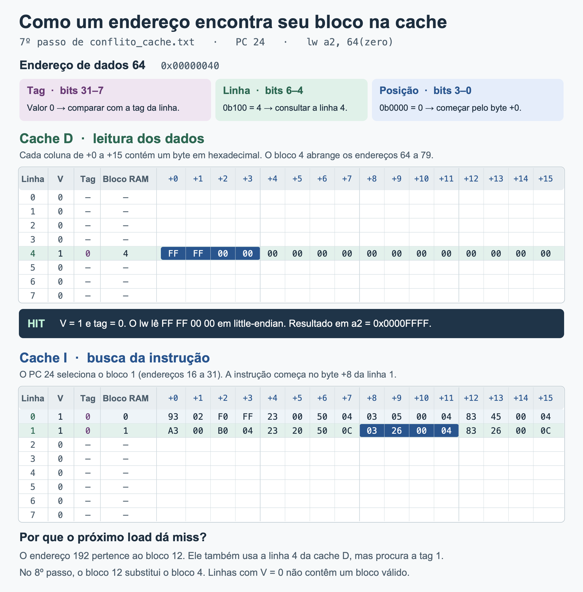

# Do Assembly ao datapath no simulador RISC-V

Ao apresentar o simulador, abra o exemplo do laço e acompanhe uma pergunta até o fim: **de onde veio o 6 que aparece em `a0`?** O programa soma 3 + 2 + 1 em um registrador, grava o resultado na RAM e o lê de volta em outro registrador. Esses doze passos permitem explicar quase todo o projeto, inclusive por que a última instrução tem um hit e um miss ao mesmo tempo.

[Abrir e testar o simulador](../README.md) · [Consultar o histórico de desenvolvimento](../handoff.md) · [Ver a tela ao fim do laço](imagens/simulador-laco.png)

## 1. Como o grupo construiu o simulador

| Etapa | Decisão e efeito no projeto | Onde estudar |
|---|---|---|
| Representar o estado | O banco guarda 32 registradores de 32 bits. A RAM guarda bytes. Assim, uma palavra ocupa quatro endereços consecutivos e o mesmo espaço pode conter código ou dados. | [Registradores](../src/registrador.cpp) e [memória](../src/memoria.cpp) |
| Interpretar instruções | O decoder separa os campos da palavra. O gerador de imediatos reúne os bits conforme o formato e preserva o sinal quando necessário. | [Decoder](../src/decoder.cpp) e [gerador de imediatos](../src/immgen.cpp) |
| Calcular e controlar | A ULA calcula sobre dois operandos. O controle da ULA identifica a operação. O controle principal seleciona os operandos, o acesso à memória, a escrita no destino e a regra do próximo PC. | [ULA](../src/ula.cpp), [controle da ULA](../src/controle_ula.cpp) e [controle principal](../src/controle.cpp) |
| Executar uma instrução completa | A CPU reúne os componentes, guarda o PC e lê os operandos antes de escrever o resultado. Com isso, o grupo já podia testar programas em código de máquina. | [Classe CPU](../include/cpu.h) e [execução](../src/cpu.cpp) |
| Escrever programas em Assembly | O montador permite usar nomes de operações, registradores e rótulos. Ele produz as mesmas palavras de 32 bits que a CPU já executava. | [Montador](../src/montador.cpp) |
| Observar a hierarquia de memória | A busca de instrução e o acesso a dados ganharam caches separadas, cada uma com suas próprias linhas e contadores. Os dois exemplos exercitam a integração. | [Mapeamento comum](../src/cache_direta.cpp), [cache I](../src/cache_instrucoes.cpp) e [cache D](../src/cache_dados.cpp) |
| Mostrar e distribuir | A interface associa cada clique a um passo da CPU e desenha o caminho percorrido. O container permite usar essa mesma aplicação pelo navegador. | [Interface](../gui/interface.cpp), [Dockerfile](../Dockerfile) e [inicialização](../docker/iniciar.sh) |

A ISA define o efeito que um programa pode observar. Por exemplo, `lw` precisa entregar a palavra do endereço calculado ao registrador de destino. A microarquitetura define como realizar isso. Neste simulador, a ULA calcula o endereço e a cache D atende à leitura em um passo da CPU. O projeto RISC-V Azedinha discute a mesma distinção ao apresentar implementações monociclo e multiciclo em VHDL. [Visão geral do SoC](https://risc-v-azedinha.github.io/RISC-V/)

## 2. Como uma linha de texto vira uma instrução

No [programa do laço](../exemplos/laco_memoria.txt), `t0`, `t1` e `a0` são nomes ABI para `x5`, `x6` e `x10`. São dois nomes para o mesmo registrador. O registrador `zero` é `x0` e sempre se lê como zero.

O montador faz duas passagens pelo texto. Na primeira, conta quatro bytes por instrução e anota em qual endereço começa cada rótulo. A linha `laco:` aponta para o endereço 4 e não ocupa espaço na RAM. Na segunda, o montador já conhece todos os destinos e pode codificar `bne t0, zero, laco`, que está em 12. O deslocamento é `4 − 12 = −8` bytes, medido a partir do PC do próprio branch. A interface carrega as palavras nos endereços 0, 4, 8 e assim por diante. A primeira busca pela CPU ainda encontrará a cache vazia.

Na execução, o decoder extrai `opcode` dos bits 6–0, `rd` de 11–7, `funct3` de 14–12, `rs1` de 19–15, `rs2` de 24–20 e `funct7` de 31–25. Esses são os nomes das posições no formato R. O **formato da instrução** determina o significado dos bits. Por exemplo, `add` e `sub` têm o mesmo opcode e o mesmo `funct3`. O controle usa `funct7` para escolher a operação.

| Formato | Como interpretar os bits no projeto |
|---|---|
| R | Usa dois registradores de origem e um destino. É o caso de `add t1, t1, t0`. |
| I | Usa `rs1` e os 12 bits superiores para o imediato em instruções como `addi` e `lw`. Nos deslocamentos imediatos, os cinco bits baixos desse campo dão a quantidade a deslocar. |
| S | O imediato do store vem em dois pedaços. O espaço usado por `rd` no formato R contém parte do deslocamento. O dado a gravar vem de `rs2`. |
| B e J | Os bits do deslocamento estão distribuídos pela palavra. O gerador os reordena, coloca zero no bit menos significativo e estende o sinal. Assim um branch pode voltar oito bytes no laço. |
| U | Os 20 bits superiores vão para as mesmas posições do resultado e os 12 inferiores ficam em zero. `LUI` e `AUIPC` usam esse imediato. |

### Nomes e usos dos registradores

O campo de registrador na instrução contém um número de 0 a 31. A ABI (*Application Binary Interface*) dá nomes a esses números e define convenções para chamadas de função. Nas janelas **Programa** e **Banco de Registradores**, `a0` e `x10` identificam o mesmo local. O zero permanente de `x0` é uma regra da arquitetura. [Registradores Risc-V, de Carlos Delfino](https://riscuinho.github.io/posts/registradores_no_risc-v/)

| Registradores | Nomes ABI | Uso convencional |
|---|---|---|
| `x0` | `zero` | Fornece o valor zero. O banco descarta escritas nesse destino. |
| `x1` | `ra` | Guarda o endereço de retorno quando a chamada usa `jal ra, alvo`. |
| `x2` | `sp` | Aponta para a pilha. |
| `x3`, `x4` | `gp`, `tp` | Ponteiros global e de thread, respectivamente. |
| `x5–x7`, `x28–x31` | `t0–t2`, `t3–t6` | Temporários. Quem chama precisa salvar os valores que pretende usar depois da chamada. |
| `x8–x9`, `x18–x27` | `s0–s1`, `s2–s11` | A função chamada deve preservar seus valores. `x8` também pode servir como ponteiro de quadro (`fp`). |
| `x10–x17` | `a0–a7` | Argumentos de função. `a0` e `a1` também servem para devolver resultados. |

Para estudar um mnemônico que aparece na janela **Programa**, consulte a tabela com um exemplo e o efeito de cada operação. [As 37 instruções do simulador](instrucoes.md)

## 3. Um passo completo, do PC ao registrador de destino

A última linha do exemplo é `lw a0, 48(zero)`. Na janela **Programa**, ela aparece no endereço 20 com a palavra `0x03002503`. Siga essa palavra pela [rotina da CPU](../src/cpu.cpp).

| Etapa em `passo_com_detalhes()` | O que acontece no último passo |
|---|---|
| 1. Busca | O PC vale 20. A cache I encontra a palavra no bloco de 16 a 31, trazido na busca anterior, quando o PC valia 16. |
| 2. Decodificação e controle | O opcode `0x03` identifica load. O `funct3 = 2` seleciona uma palavra de quatro bytes. O destino é `rd = x10`, a base é `rs1 = x0` e o imediato é 48. |
| 3. Leitura dos operandos | O banco entrega zero para a base. O controle seleciona o imediato 48 como segundo operando. |
| 4. Execução | A ULA faz `0 + 48`. O resultado 48 é o **endereço** do dado. |
| 5. Memória de dados | O store anterior deixou os bytes `06 00 00 00` a partir de 48 na RAM. O load dá miss na cache D, traz o bloco de 48 a 63 e lê a palavra 6 em ordem *little-endian*. |
| 6. Escrita e próximo PC | O controle seleciona o valor lido da memória. O banco grava **6** em `a0` e o PC avança de 20 para 24. A interface encerra a execução porque o código carregado termina no endereço 23. |

Na captura, **Ultimo passo** mostra também `rs2=x16`. O decoder extraiu mecanicamente os bits 24–20. Como `lw` é do tipo I, esses bits fazem parte do imediato 48. Observe no painel o sinal **Operando B: imediato** para descobrir o que realmente entrou na ULA.

A CPU também oferece `passo()` para quem só quer executar. A interface usa `passo_com_detalhes()` para recuperar os operandos originais, o resultado da ULA, a palavra executada e o PC antes e depois. Ao desenhar essas informações, a GUI preserva os contadores. Isso importa em `addi t0, t0, -1`, pois depois do passo o banco já contém o novo `t0`, enquanto a seta de entrada da ULA deve mostrar o antigo.

### O que muda nas outras instruções?

| Família | Origem do resultado e efeito |
|---|---|
| Aritmética e lógica | A ULA recebe dois registradores ou um registrador e um imediato. O resultado vai para `rd`. Comparações podem interpretar os mesmos bits com sinal (`SLT`) ou sem sinal (`SLTU`). |
| LUI e AUIPC | Ambas usam o imediato U. Para campo superior 1 e PC igual a 16, `LUI` escreve 4096 e `AUIPC` escreve 4112. Ambas seguem para PC 20. |
| Loads e stores | Ambos usam `rs1 + imediato` como endereço. `SB`, `SH` e `SW` gravam os 8, 16 ou 32 bits baixos de `rs2`. `LB/LBU`, `LH/LHU` e `LW` leem essas larguras para `rd`. O simulador exige endereço par para meia-palavra e múltiplo de quatro para palavra. |
| Branches | A ULA compara dois registradores. Se a condição vale, o PC recebe `PC + deslocamento`. Caso contrário, recebe `PC + 4`. Um branch preserva o banco de registradores. |
| JAL e JALR | Ambos oferecem `PC + 4` a `rd` como endereço de retorno. `JAL` salta para `PC + imediato`. `JALR` usa o valor original de `rs1 + imediato` e limpa o bit 0 do destino. Neste simulador, o endereço final de instrução precisa ser múltiplo de quatro. |

## 4. Como explicar as duas caches usando os exemplos

A cache I atende à busca pelo PC. A cache D atende a loads e stores. Cada uma tem **8 linhas × 16 bytes = 128 bytes** de conteúdo, além da tag e do bit de validade de cada linha. Um bloco de 16 bytes acomoda quatro instruções consecutivas. O primeiro acesso pode trazer vizinhos que o programa usará logo depois (*localidade espacial*). Quando o laço volta ao mesmo endereço, ele reaproveita uma instrução já buscada (*localidade temporal*).

No mapeamento direto, divida o endereço por 16 para obter o número do bloco, com divisão inteira. O resto dessa divisão indica o byte dentro do bloco. Divida agora o número do bloco por 8. O resto escolhe a linha, e o quociente é a tag. Um hit exige linha válida e tag correspondente.

| Acesso | Efeito na cache de dados e na RAM |
|---|---|
| Load com hit | Lê os bytes da linha. A CPU aplica a extensão de sinal em `LB` e `LH`, ou completa com zeros em `LBU` e `LHU`. |
| Load com miss | Copia da RAM o bloco que contém o endereço e entrega os bytes solicitados. |
| Store com hit | Atualiza os bytes tanto na linha quanto na RAM no mesmo passo. É *write-through* sem buffer de escrita. |
| Store com miss | Grava na RAM e preserva a linha que ocupava o índice. É *write-around*. |

**Primeira demonstração.** No laço, a busca em 0 traz as instruções dos endereços 0, 4, 8 e 12. As duas voltas do branch reaproveitam esse bloco. A busca em 16 traz o segundo bloco, onde também está a instrução do endereço 20. Resultado de 12 buscas: **10 hits e 2 misses**. Na cache D, o store em 48 dá miss e escreve na RAM sem alocar. O load seguinte precisa trazer o bloco. Resultado de dois acessos: **0 hits e 2 misses**.

Para ler a figura, siga o endereço 64. O índice escolhe a linha 4 da cache D. O bit de validade vale 1 e a tag da linha coincide com a tag 0 do endereço, confirmando o hit. A posição +0 indica o primeiro byte. Como a instrução é um `lw`, a CPU reúne quatro bytes consecutivos: `FF FF 00 00` em ordem de endereço formam a palavra `0x0000FFFF` (65535) em `a2`.

**Segunda demonstração.** Abra o [exemplo de conflito](../exemplos/conflito_cache.txt). Os endereços 64 e 192 pertencem aos blocos 4 e 12. Os dois usam o índice 4 e têm tags 0 e 1. No 6º passo, o store em 192 dá miss e preserva o bloco de 64. No 7º, a leitura em 64 dá hit, o que permite demonstrar *write-around* na tela. No 8º, a leitura em 192 substitui a linha. No 9º, ler 64 novamente dá miss. Ao final, a cache D contabiliza **3 hits e 5 misses**.

## 5. Roteiro de apresentação com o simulador aberto

| Momento | Ação | O que mostrar à turma |
|---|---|---|
| Programa carregado | Abra o exemplo do laço e use **Reset**. | Há seis instruções, PC = 0 e contadores zerados. A coluna **Assembly** mostra o que o grupo escreveu e **Palavra** mostra o que a CPU busca. |
| Primeiro passo | Clique em **Passo** uma vez. | `addi` coloca 3 em `t0` e o PC vai a 4. A busca dá miss. No passo seguinte, a busca em 4 aproveita o bloco que já chegou. |
| Laço | Pare após os passos 4, 7 e 10. | Nos dois primeiros, `t0` vale 2 e 1, respectivamente, e o PC volta a 4. No terceiro, `t0 = 0`, a soma em `t1` chegou a 6 e o PC segue para 16. |
| Gravação e leitura | Execute o 11º e o 12º passos separadamente. | No `sw`, aponte o endereço 48 na saída da ULA e o dado 6 vindo de `t1`. No `lw`, siga a seta de retorno até `a0`. Termine comparando os contadores das duas caches. |
| Distribuição e testes | Mostre como reproduzir a mesma execução em outra máquina. | No macOS a janela pode ser nativa. Em Docker, a aplicação C++ desenha em um display virtual (Xvfb). O x11vnc compartilha a tela e o websockify permite que o noVNC a exiba no navegador. O teste de integração monta os mesmos arquivos da apresentação e confere PC, registradores e contadores. |

## 6. Perguntas de sabatina

**O que significa monociclo aqui?** Uma chamada de passo completa uma instrução antes de começar a seguinte. Busca, decodificação, execução, memória e escrita são etapas lógicas desse passo. O controle **Passos/s** ajusta o ritmo da demonstração. Os contadores medem acessos e acertos, sem atribuir latências em ciclos aos misses.

**Por que o programa tem seis instruções e termina em doze passos?** A inicialização executa uma vez, as três instruções do corpo executam três vezes cada e as duas operações de memória executam uma vez cada. São `1 + 3 × 3 + 2 = 12` passos.

**Por que o PC avança de quatro em quatro se a RAM guarda bytes?** O PC contém um endereço em bytes. Cada instrução deste subconjunto ocupa quatro bytes. A palavra no endereço 20 ocupa os bytes de 20 a 23.

**Por que uma cache de 128 bytes para um processador de 32 bits?** Os 32 bits indicam, entre outras coisas, a largura dos registradores. A capacidade da cache vem de uma escolha didática independente. Com oito linhas de 16 bytes, um programa curto já demonstra reutilização e conflito sem exigir uma lista longa de endereços.

**Como o mesmo byte pode produzir −1 e 255?** No exemplo de conflito o byte armazenado é `0xFF`. `LB` replica o bit de sinal e produz `0xFFFFFFFF`. `LBU` completa a parte alta com zeros e produz `0x000000FF`. A diferença aparece no valor escrito no registrador.

**O que ocorre quando um store altera código já buscado?** Código e dados compartilham a RAM. A CPU sincroniza os bytes na cache I se o bloco já estiver lá. Essa atualização preserva o contador de buscas. A janela **Programa** conserva a listagem carregada e **Ultimo passo** usa a palavra efetivamente executada.

**O simulador cobre todo o RISC-V?** O escopo demonstrado são as 37 instruções listadas no README. A ISA define o efeito observável de cada uma. Monociclo, tamanho das caches e apresentação do datapath são escolhas desta implementação. O diagrama de pipeline em `modelo-de-estudo/` serve como referência para comparação. [Instruções implementadas](../README.md#instruções-implementadas)

**Como sustentar que a demonstração está correta?** O grupo pode repetir o exemplo a partir de **Reset**, prever os três destinos do `bne` e conferir o valor final em `a0`. Os quatro testes automatizados verificam a CPU, cada cache e a integração do montador com os programas da demonstração. O teste do container verifica a inicialização da aplicação e dos serviços de acesso remoto. [Comandos e testes](../README.md#como-compilar-e-testar) · [Asserções dos dois exemplos](../tests/teste_montador_cpu.cpp) · [Verificação do container](../.github/workflows/docker.yml)
